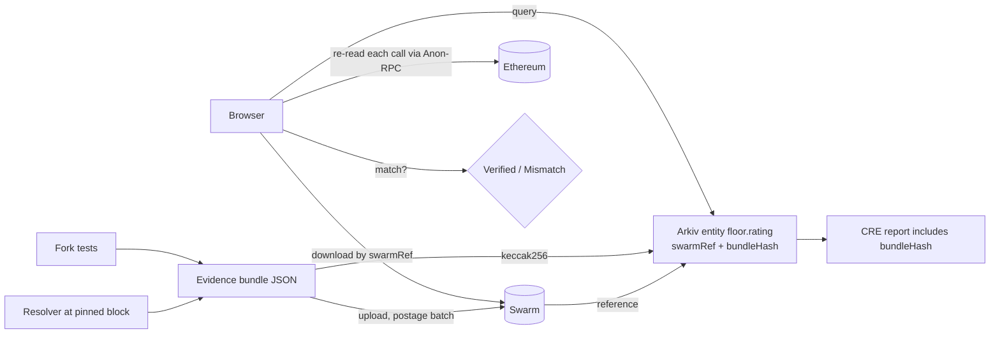

# 20 · Swarm design: evidence on Swarm, index on Arkiv

**Goal:** every Floor grade can be re-checked by anyone without trusting Floor's servers. Arkiv answers "which assets are BREACHED?"; Swarm holds the proof behind each answer; the browser verifies the proof against the chain through Anon-RPC.

Prize fit:
- **Arkiv + Swarm bonus ($500):** "The most useful integration wins." The bonus needs both Arkiv and Swarm, plus `/arkiv/swarm.md` ([11](11-sponsors-and-prizes.md)).
- **EF CROPS:** EF's own example, "a frontend that keeps working when its domain, backend or RPC provider disappears".

Dev reference (bee-js, stamps, feeds): [19 §4](19-sponsor-dev-reference.md#4-swarm).

## Priority

| # | Use | Priority |
|---|---|---|
| 1 | Evidence bundle per rating on Swarm; Arkiv entity stores the reference + hash | **Must have** |
| 2 | Browser verifier downloads the bundle from Swarm and re-checks each value via Anon-RPC | **Must have** (this is the CROPS demo moment) |
| 3 | Static site hosted on Swarm behind a feed manifest (stable URL) | Should have. **Status 2026-11-07:** site on Swarm on every deploy; feed manifest not done (new reference each deploy) |
| 4 | "Latest rating" feed per asset | Should have |

**No encryption anywhere.** Evidence is public by design. That avoids the "encrypted reference in a public entity" trap entirely.

## Data flow



The same `bundleHash` appears in three places: the Arkiv entity, the CRE-signed report in `FloorRegistry`, and the bundle itself. If any one differs, the UI shows **Mismatch**.

## Evidence bundle format (v0)

`application/json`, one file per (asset, scan block).

```json
{
  "schema": "floor.evidence/v0",
  "asset": { "symbol": "rsETH", "chain": "ethereum", "token": "0x…", "oapp": "0x85d456B2DfF1fd8245387C0BfB64Dfb700e98Ef3" },
  "scan": { "chainId": 1, "block": 24908284, "blockHash": "0x…", "timestamp": 0, "rpcProviders": ["drpc", "publicnode"], "rpcAgreement": true },
  "rulePack": { "id": "aave-rf", "version": "0.1.0", "frameworkVersion": "LlamaRisk v1.2 (2026-10-06)", "hash": "0x…" },
  "grade": "BREACHED",
  "routes": [
    {
      "eid": 30320, "direction": "receive",
      "effective": { "confirmations": 42, "requiredDVNs": ["0x589d…236b"], "optionalDVNs": [], "optionalThreshold": 0 },
      "operators": ["LayerZero Labs"], "effectiveIndependent": 1,
      "receiveLibrary": { "address": "0xc02A…24C2", "isDefault": true, "timeout": null },
      "results": [
        { "rule": "AAVE-RF-2.2", "outcome": "BREACHED", "reason": "1 effective independent verifier (<3)" },
        { "rule": "AAVE-RF-2.4", "outcome": "BREACHED", "reason": "receive library unpinned" }
      ]
    }
  ],
  "controllers": { "owner": { "address": "0xCbcd…29A1", "type": "safe", "threshold": 3, "owners": 6, "modules": 0, "guard": null }, "delegate": { "same": "owner" }, "timelock": null },
  "forkTests": [ { "name": "inbound-limit", "forkBlock": 0, "outcome": "NO_INBOUND_LIMIT", "revert": null, "scriptHash": "0x…" } ],
  "calls": [
    { "id": "c1", "to": "0xc02Ab410f0734EFa3F14628780e6e695156024C2", "sig": "getUlnConfig(address,uint32)", "args": ["0x85d4…", 30320], "block": 24908284, "result": "0x…" },
    { "id": "c2", "to": "0x1a44076050125825900e736c501f859c50fE728c", "sig": "getReceiveLibrary(address,uint32)", "args": ["0x85d4…", 30320], "block": 24908284, "result": "0x…" }
  ],
  "generator": { "name": "floor-resolver", "version": "0.1.0", "commit": "<git sha>" }
}
```

Rules:
- Every value used in a result must trace to a `calls[]` entry (raw return data). That is what the browser re-checks.
- `bundleHash = keccak256(canonical JSON bytes)`, with sorted keys and no whitespace.
- Size target: under 128 KiB, so the same bytes could also fit an Arkiv `bytes` column if Swarm is unavailable (fallback).

## Arkiv ↔ Swarm link

Arkiv schema `floor.rating` (owned by Floor's writer wallet; queries always `.createdBy(writer)`):

| Field | Type | Indexed | Purpose |
|---|---|---|---|
| `token` | `addr` | yes | asset |
| `chainId` | `dec` | yes | chain |
| `grade` | `str` | yes | OK / DEGRADED / BREACHED / UNKNOWN |
| `block` | `dec` | yes | scan block |
| `ruleVersion` | `str` | yes | rule pack version |
| `swarmRef` | `str` | no | 64-hex Swarm reference (unencrypted) |
| `bundleHash` | `str` | no | keccak256 of the bundle |
| `feed` | `str` | no | feed manifest reference for the "latest" view (optional) |

Expiration: `ExpirationTime.fromDays(180)` (max ~182.5 days). The importer re-creates or extends entities on each scan.

## Browser verification (Use 2)

1. Query Arkiv for the asset's latest `floor.rating` owned by Floor's writer.
2. Download the bundle from Swarm by `swarmRef`, either through a public gateway (`bzz.limo` / `gateway.ethswarm.org`) or a Bee node. Recompute `keccak256`; it must equal `bundleHash`.
3. For each `calls[]` entry, redo the `eth_call` at `block` **through Anon-RPC**, and compare with `result`.
4. Re-run the rule pack (pure function, shipped in the page) over the verified values; the grade must match.
5. Optionally, read `FloorRegistry` and check that the CRE report's `bundleHash` matches.
6. Show: `Verified ✓ (N/N calls matched, grade reproduced)` or the exact mismatch.

The CROPS demo moment: kill the Floor backend (and, with Use 3, the domain), click **Verify**, and it still works: Arkiv, Swarm and Anon-RPC only.

## Site on Swarm (Use 3)

- Build the static site; `bee.uploadFilesFromDirectory(batchId, "./dist")` (Node), with an index document.
- Publish through a feed manifest (`bee.createFeedManifest(batchId, topic, owner)`), so the URL `/bzz/<manifest>/` stays fixed across redeploys.
- Must work fully client-side (no backend calls on the verification path).

## Postage and upload path

- **Hackathon:** Beeport (hosted, buy stamps without a node), or a Bee light node on mainnet (Gnosis: xDAI for gas, xBZZ for stamps). Use an **immutable** batch if feeds are used. bee-factory is for local dev only; judges can't reach it.
- Record for `swarm.md`: batch ID, buying wallet (or "Beeport"), Bee node/service URL.
- Cost: an example batch (depth 20) was estimated at ≈0.010 BZZ (docs). Real cost depends on depth and TTL (ESTIMATE).

## Failure modes

| Failure | Behaviour |
|---|---|
| Swarm reference not retrievable | UI shows `UNKNOWN (evidence unavailable)`, never `Verified`. Fallback: bundle bytes in an Arkiv `bytes` column if ≤128 KiB |
| Hash mismatch | `Mismatch`: show which source disagrees |
| Anon-RPC read fails | Retry. Otherwise show `Unverified (RPC)`, and say whether a direct read was used (counted in the traffic-share metric) |
| Arkiv entity not owned by the writer | Ignore it (anyone can write to a schema name) |

## Draft `/arkiv/swarm.md` outline (required items)

1. **What's on Swarm vs Arkiv.** Swarm: evidence bundles (+ site). Arkiv: `floor.rating` index. The Swarm reference lives in `swarmRef`, the hash in `bundleHash`.
2. **One entity key + its Swarm reference,** with an openable link (gateway URL).
3. **Postage batch ID,** the wallet that bought it (or Beeport), and the Bee node/service used.
4. **Files that upload and read:** e.g. `packages/evidence/upload.ts`, `apps/web/src/verify.ts`.
5. **Steps to run one upload and one read,** what they need, and expected output.
6. **The demo-video timestamp** where Swarm is used (the backend-off Verify moment).
7. **What got in our way** with Swarm (fill in as we go).

## Build tasks (~2–3 h)

1. Canonical JSON + hash in the resolver output (30 min).
2. Upload via bee-js; write `swarmRef` + `bundleHash` into the Arkiv entity (45 min).
3. Browser: fetch bundle → hash check → re-read calls via Anon-RPC → re-grade (60 min).
4. `swarm.md` (15 min). Site on Swarm if time allows.
